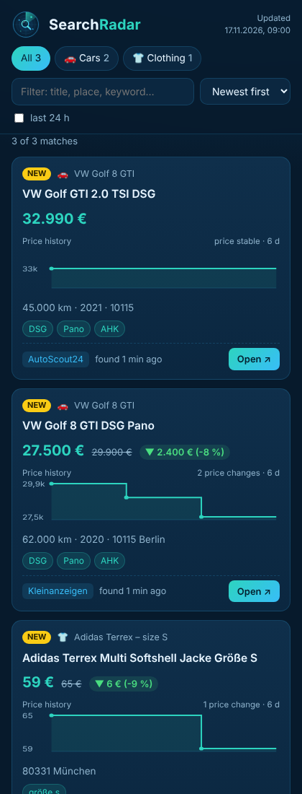

<p align="center">
  
</p>

<h1 align="center">SearchRadar</h1>

<p align="center">
  Hourly marketplace search for <b>anything</b> – cars, bikes, monitors, clothing, … –<br>
  that only pings you on Telegram when a listing really meets your criteria.
</p>

---

## Why

Browsing classifieds by hand takes forever. SearchRadar checks your saved searches on
**AutoScout24**, **mobile.de** and **Kleinanzeigen** every hour, applies realistic **minimum criteria**
(price range, mileage, year, required equipment, red-flag words), and sends a Telegram message
only for listings that pass **all** of them. Each topic lands in its own Telegram forum topic.

In parallel, a **web overview** lists every match that is **still online** – with link, details and a
**price-history chart**. Listings that were sold or deleted disappear automatically, price drops are
announced on Telegram.

<p align="center"></p>

## How it works

```
searches/cars.json ─┐                         ┌─► Telegram topic "Cars"
searches/bikes.json ├─► GitHub Action (hourly) ├─► Telegram topic "Bikes"
searches/….json    ─┘   fetch → parse → filter └─► Telegram topic "…"
                              │
                  state/seen.json     (no duplicate alerts)
                  state/matches.json  (active matches + price history)
                              │
                              ├─► site/index.html  → GitHub Pages (optional)
                              └─► RESULTS.md       → readable in the repo / GitHub app
```

1. You set up a search on the portal (category, keywords, **postcode + radius**, e.g. 100 km), sort by **newest first** and copy the URL.
2. Every hour the action loads the first result page, detects **new** listings and checks them against your filters.
3. If required keywords aren't on the result card, the **detail page** is loaded and searched too (equipment is often listed only there).
4. Matches are sent to the Telegram topic of that file. `state/seen.json` remembers what was already handled.

5. Every stored match is **re-checked**: if it is still on a result page its price is updated right there,
   otherwise its detail page is visited (up to `max_rechecks_per_run` per run, oldest check first).
   Every price change is added to its history; a lower price triggers a 📉 Telegram message.
   A listing that is **gone** (404, redirect, "nicht mehr verfügbar", title "Gelöscht/Verkauft") in two
   consecutive checks is removed. A blocked request never counts as gone.

On the **first run** of a search all current listings are marked as seen silently, so you aren't flooded with old stock.

## Setup

### 1. Telegram bot and group with topics
1. In Telegram, message **@BotFather** → `/newbot` → note the **bot token**.
   Optional: `/setuserpic` with `assets/logo.png`.
2. Still in @BotFather: `/setprivacy` → your bot → **Disable** (so the bot sees messages in topics, needed once for the ids).
3. Create a **group**, open its settings and turn on **Topics**. Add your bot as **admin**.
4. Create one topic per search file, e.g. *Cars*, *Bikes*, *Monitors* (optionally *Alerts*).
5. Write any message in **each** topic.
6. Get the ids – **no computer needed**: add the secret `TELEGRAM_BOT_TOKEN` (step 2) first, then
   **Actions → SearchRadar → Run workflow** with *Setup: only show Telegram chat/topic ids* ticked and open
   the step *Show Telegram ids* in the job log. Alternatively on a computer:
   ```bash
   pip install -r requirements.txt
   TELEGRAM_BOT_TOKEN=123:abc python -m searchradar --telegram-ids
   ```
   → shows the group's `chat_id` (starts with `-100…`) and the `thread_id` of every topic.
   *(Without a computer: open `https://api.telegram.org/bot<TOKEN>/getUpdates` in a browser and look for `"chat":{"id":…}` and `"message_thread_id"`.)*

### 2. Repository secrets
GitHub → repo → **Settings → Secrets and variables → Actions → New repository secret**
| Secret | Value |
|---|---|
| `TELEGRAM_BOT_TOKEN` | the bot token |
| `TELEGRAM_CHAT_ID` | the group id, e.g. `-1001234567890` |

### 3. Configure searches
Edit the files in `searches/`: put your search URLs in, set `telegram_thread_id`, and set `"enabled": true`.

### 4. Web overview (optional)
`RESULTS.md` in the repo is always updated – open it in the GitHub app for a quick list with links.

For the full page with filters and price charts, use **GitHub Pages**:
1. **Settings → Pages → Build and deployment → Source: GitHub Actions**
2. **Settings → Secrets and variables → Actions → Variables → New repository variable**: `PAGES_ENABLED` = `true`
3. After the next run the page is at `https://<user>.github.io/SearchRadar/`

> Pages for a **private** repo needs a paid GitHub plan (Pro/Team). The published page itself is publicly
> reachable for anyone who knows the URL (it is marked `noindex`, but not password-protected).
> It only contains public listing data, but it reveals what you are looking for. Without Pages,
> use `RESULTS.md` – it stays private with the repo.

### 5. Test
**Actions → SearchRadar → Run workflow** with *Send Telegram test message* ticked → every enabled topic gets a test message.
Then run it once without the tick. From then on it runs hourly by itself.

> Keep the repo **private** – nobody sees your searches, the free 2,000 Action minutes/month are plenty (≈1 min per run), and GitHub only disables schedules of *public* repos after 60 days without activity.

## Configuration

### `settings.json` (global)
| Key | Default | Meaning |
|---|---|---|
| `notify_on_first_run` | `false` | also report existing listings when a search is new |
| `max_notifications_per_run` | `30` | protection against message floods (rest follows next run) |
| `max_detail_checks_per_run` | `25` | detail pages loaded per run (rest follows next run) |
| `request_delay_seconds` | `[3, 7]` | random pause between requests |
| `alerts_thread_id` | `null` | Telegram topic for warnings (null = General) |
| `max_rechecks_per_run` | `40` | stored matches re-visited per run (still online? current price?) |
| `notify_price_drops` | `true` | Telegram message when a stored match gets cheaper |

### `searches/<topic>.json` (one file per topic)
```jsonc
{
  "topic": "Cars",                 // shown as #Cars in messages
  "emoji": "🚗",
  "telegram_thread_id": 11,        // forum topic id (null = General)
  "telegram_chat_id": null,        // optional: other chat than TELEGRAM_CHAT_ID
  "enabled": true,                 // switch the whole topic on/off
  "defaults": {                    // merged into every search of this file
    "must_not_contain": ["Unfall", "defekt"],
    "require_known": ["price"],
    "check_details": true
  },
  "searches": [
    {
      "name": "VW Golf 8 GTI",
      "enabled": true,             // optional, default true
      "urls": ["https://www.autoscout24.de/lst/…", "https://www.kleinanzeigen.de/s-autos/…"],
      "filters": {
        "min_price": 15000, "max_price": 40000,
        "max_mileage": 80000, "min_mileage": null,
        "min_year": 2020, "max_year": null,
        "title_must_contain": ["GTI"],
        "must_contain": ["DSG", ["Pano", "Panorama"]],
        "must_not_contain": ["Export"],
        "require_known": ["price", "mileage"],
        "check_details": true
      }
    }
  ]
}
```

| Filter | Meaning |
|---|---|
| `min_/max_price`, `min_/max_mileage`, `min_/max_year` | numeric limits. A value missing on the listing does **not** reject it … |
| `require_known` | … unless it's listed here (`price`, `mileage`, `year`, `location`) |
| `title_must_contain` | every entry must appear in the **title** |
| `must_contain` | every entry must appear in title, card text **or detail page** |
| `must_not_contain` | reject if any word appears (card or detail page) |
| `detail_must_not_contain` | always loads the detail page and rejects on a hit there – for spec fields like colour: `"re:außenfarbe\\W*schwarz"` (not black, black seats still OK) |
| `check_details` | load the detail page when required keywords are missing on the card |

**Keyword rules:** case-insensitive, matched at the **start of a word** – `Pano` matches *Panoramadach*, `suche` does not match *versuche*.
An entry that is a **list** means "one of these": `["AHK", "Anhängerkupplung"]`.
For exact patterns use a regular expression with the prefix `re:` (applied to the lower-cased text) –
e.g. clothing size S without matching *XS* or *Schwarz*: see `searches/clothing.json`.
Keywords must be written in the language of the listings (German for German portals).

Tips for realistic minimum criteria:
- Always set a `min_price` – it filters out "price on request", spare parts and fake listings.
- Add `"Suche"`/`"Gesuch"` to `must_not_contain` on Kleinanzeigen to skip wanted ads.
- Put the most important property into `title_must_contain` – it's cheap and very precise.

### Creating search URLs
| Portal | How |
|---|---|
| AutoScout24 | set filters, postcode + radius, sort by *newest first*, copy URL (`zip=…&zipr=100&sort=age&desc=1`) |
| mobile.de | detailed search, postcode + radius, sort by *newest listings first*, copy URL |
| Kleinanzeigen | any category, keywords, postcode + "+ 100 km", filters, copy URL (ends e.g. in `…r100`) |

If an AutoScout24 or mobile.de URL has no sort order, *newest first* is added automatically.

## Good to know

- **mobile.de blocks automated requests heavily**, especially from data-centre IPs such as GitHub's. SearchRadar uses a Chrome TLS fingerprint (`curl_cffi`), but if it still gets 403/captcha you'll get a warning after 3 failed runs in a row – use mobile.de's own saved-search alerts in that case. AutoScout24 and Kleinanzeigen usually work much better.
- Portals change their HTML from time to time. If a page suddenly yields **0 listings**, that counts as a failure and triggers the same warning – the parser in `searchradar/portals/` then needs an update.
- Changed your filters and want old listings re-evaluated? Rename the search or delete its lines in `state/seen.json`.
- The portals' terms generally prohibit automated access. SearchRadar is meant for personal use with a handful of requests per hour; use at your own responsibility.

## Command line

```bash
pip install -r requirements.txt
python -m searchradar --validate                  # check config files
python -m searchradar --dry-run -v                # nothing sent/saved, show reject reasons
python -m searchradar --dry-run --topic cars      # only one topic file
python -m searchradar --search "VW Golf 8 GTI"    # only one search
python -m searchradar --test-telegram             # test message to every topic
python -m searchradar --telegram-ids              # list chat / topic ids
python -m searchradar.site                        # build site/index.html + RESULTS.md
python -m pytest -q                               # tests
```

## Adding a portal

1. `searchradar/portals/<name>.py` with `parse(html: str) -> list[Listing]`
2. register it in `PORTALS` in `searchradar/portals/__init__.py`
3. add a test with a small HTML sample in `tests/`

The Claude skill in `.claude/skills/searchradar/` describes these steps in detail.
